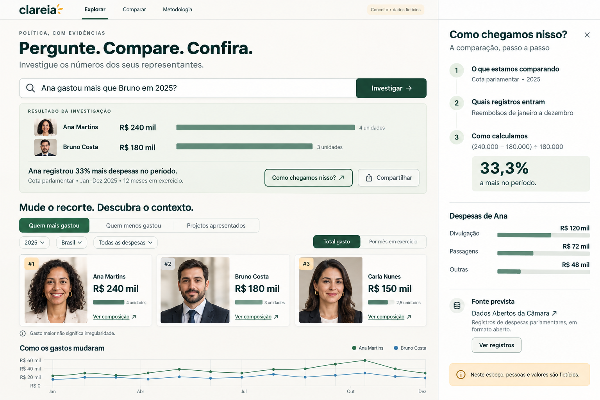
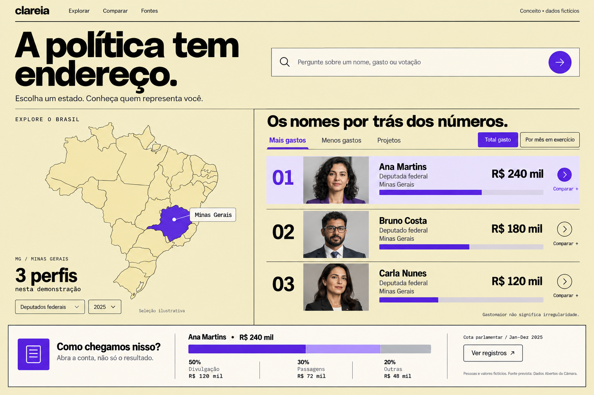

# Clareia — ideias e direção da plataforma

> Documento de trabalho · 31 de outubro de 2026  
> Idioma do produto: português brasileiro.  
> **Clareia é um nome provisório.** Marca e domínio ainda não foram verificados.

## 1. Visão

Criar um portal bonito, intuitivo e interativo para entender a atuação de políticos brasileiros a partir de dados públicos verificáveis.

**Promessa do produto:** “Entenda quem te representa, o que faz e como usa o dinheiro público.”

O portal deve ajudar uma pessoa a encontrar uma resposta útil rapidamente e permitir que ela aprofunde a consulta até chegar ao registro oficial. A experiência precisa funcionar bem no celular e para quem não conhece o vocabulário do Legislativo.

A ambição é reunir diferentes dimensões da vida pública: mandatos, gastos, votos, propostas, eleições, patrimônio declarado e destinação de recursos. A cobertura deve crescer gradualmente, conforme a qualidade e a disponibilidade de cada fonte.

**Direção da abertura:** mostrar primeiro as pessoas. Fotos de parlamentares em rankings de maiores gastos, menores gastos e mais projetos apresentados dão acesso imediato à exploração. Em seguida, gráficos e mapas interativos ajudam a entender padrões. Uma busca com respostas rápidas baseadas nos dados é uma possibilidade central a desenvolver.

## 2. O que já está definido e o que continua em aberto

| Tema | Direção atual | Situação |
| --- | --- | --- |
| Público principal | Cidadãos que querem entender e acompanhar seus representantes | Escolhido |
| Idioma | Português brasileiro | Definido |
| Experiência | Acessível, visualmente cuidada e fácil de explorar | Escolhido |
| Base de informação | Fontes oficiais, com origem e período visíveis | Proposta central |
| Primeiro recorte | Deputados federais | Recomendado, ainda aberto |
| Nome | Clareia | Provisório |
| Logotipo | Palavra clareia em minúsculas com raios dourados à direita | Aprovado pelo usuário; presente nas três interfaces |
| Composição visual | Investigação verde, Explorador escuro e Editorial azul | Três páginas completas para comparação; escolha final em aberto |
| Página inicial | Fotos e rankings primeiro; gráficos e mapas na sequência | Direção escolhida |
| Rankings de abertura | Quem mais gastou, quem menos gastou e quem apresentou mais projetos | Direção escolhida; métricas a validar |
| Busca como assistente de investigação | Perguntas em linguagem natural geram comparações, contexto e acesso às evidências | Direção escolhida; implementação após validar a base |
| Como chegamos nisso? | Todo número relevante permite abrir cálculo, recorte e registros de origem | Direção escolhida |
| Rankings como descobertas interativas | Alterar período, grupo e métrica para explorar como a classificação muda | Direção escolhida; regras das métricas a validar |
| Tecnologia e hospedagem | Proposta de TypeScript, Next.js, PostgreSQL e serviços gerenciados | Recomendação registrada; escolha final em aberto |

O trabalho já inclui um [MVP local das três interfaces escolhidas](mvp/index.html): Investigação verde, Explorador escuro e Editorial azul. Após a remoção dos protótipos anteriores, o usuário solicitou uma nova implementação baseada nas três imagens de referência. Busca demonstrativa, rankings, filtros e evidências funcionam com registros fictícios; ainda não existe integração de dados oficiais, IA conectada ou produto publicado. Consulte as [instruções e capturas verificadas](mvp/README.md).

**Expansão de interface — 1º de novembro de 2026:** as três alternativas agora incluem a página completa: panorama, exploração de despesas por período/categoria/fornecedor, mapa esquemático das 27 UFs, diretório com filtros, comparador, projetos e tramitação, cenários de votação, dossiês de eleições/patrimônio/emendas, linha do tempo, favoritos locais e assistente demonstrativo. As composições têm movimento próprio, com controle de animações e respeito à preferência de movimento reduzido. A cobertura continua sendo uma amostra fictícia; expandir a interface não equivale a implementar as integrações previstas no roadmap.

## 3. Perguntas que organizam o produto

### Quem me representa?

- Encontrar parlamentares por nome, estado, partido e situação do mandato.
- Entender cargo, período em exercício e trajetória política.
- Distinguir quem está em exercício, quem foi eleito para um mandato futuro e quem já deixou o cargo.
- Explorar mudanças de partido e mandatos anteriores, quando a fonte permitir.

### Onde gastou?

- Consultar despesas por período, categoria e fornecedor.
- Ver a evolução mensal e abrir os registros que compõem um total.
- Acessar documentos e comprovantes quando estiverem disponíveis.
- Comparar despesas equivalentes, com período e grupo de comparação explícitos.

### Como votou?

- Entender o objeto da votação em linguagem simples.
- Ver o voto nominal do parlamentar e o resultado da votação.
- Distinguir sim, não, abstenção, ausência e outras situações informadas pela fonte.
- Separar o voto em uma etapa do projeto da aprovação final de uma lei.

### O que propôs?

- Conhecer propostas de autoria e coautoria do parlamentar.
- Acompanhar apresentação, análise nas comissões e demais etapas pertinentes.
- Distinguir projetos apresentados, arquivados, aprovados e transformados em lei.
- Explorar assuntos como saúde, educação, segurança e meio ambiente, com classificação documentada.

### Como posso acompanhar?

- Comparar dois parlamentares com as mesmas métricas e o mesmo período.
- Compartilhar uma consulta mantendo seus filtros e contexto.
- Salvar perfis favoritos; avaliar alertas de novidades em uma fase posterior.

## 4. Estrutura sugerida do portal

| Área | Função principal | Prioridade sugerida |
| --- | --- | --- |
| Início | Apresentar fotos e rankings, seguidos de gráficos e mapas interativos | Primeira versão |
| Rankings | Explorar maiores e menores gastos e mais projetos apresentados | Primeira versão |
| Explorar representantes | Busca e filtros simples, com resultados legíveis | Primeira versão |
| Perfil do parlamentar | Reunir identidade, atuação e acesso aos detalhes | Primeira versão |
| Gastos | Gráficos e registros de despesas com rastreabilidade | Primeira versão |
| Gráficos e mapa | Explorar evolução, categorias e recortes por estado | Primeira versão, conforme a cobertura |
| Busca com respostas | Interpretar perguntas e apresentar respostas com fontes e consultas reproduzíveis | Piloto após validar a base |
| Votações | Explicar o que foi votado e apresentar o voto registrado | Expansão próxima, com recorte explícito |
| Comparar | Colocar dois perfis lado a lado | Após validar as métricas |
| Projetos | Sustentar o ranking de projetos apresentados e permitir abrir seus registros | Contagem e registros na primeira versão; tramitação detalhada depois |
| Eleições e patrimônio | Conectar candidaturas, bens declarados e contas eleitorais | Expansão posterior |
| Recursos para localidades | Explorar emendas e execução financeira por destino | Expansão posterior |
| Fontes e metodologia | Explicar cobertura, atualização, definições e cálculos | Desde o início |

### O perfil como centro da experiência

O perfil deve começar com nome, foto quando disponível, cargo, partido, estado e situação do mandato. Um seletor de período deve deixar claro a que momento os dados se referem.

Organização sugerida:

`Visão geral · Gastos · Votações · Projetos · Trajetória · Eleições e patrimônio`

As seções entram conforme houver dados confiáveis. A visão geral deve ter poucos indicadores, explicações curtas e caminhos claros para aprofundamento.

## 5. Direção visual e interação

### Personalidade

Uma experiência visual, clara e acolhedora, com rostos reconhecíveis e dados que convidam à exploração. Fundos suaves, verde profundo como acento, boa tipografia e espaço suficiente entre os elementos. A identidade visual deve permitir leitura confortável e não atribuir significado político às cores decorativas.

### Página inicial: pessoas → rankings → gráficos → mapas

Os rankings devem aparecer logo na primeira tela, sem um bloco de apresentação alto empurrando as fotos para baixo. A busca fica no cabeçalho compacto e acompanha a navegação; a experiência principal funciona mesmo sem usar o assistente.

Ordem proposta:

1. **Cabeçalho compacto:** marca, busca por nome ou pergunta e acesso à metodologia.
2. **Contexto da consulta:** Casa legislativa, período e filtros de estado e partido. A seleção se aplica aos rankings e às visualizações compatíveis.
3. **Três grupos de destaques:** “Quem mais gastou”, “Quem menos gastou” e “Quem apresentou mais projetos”, com retratos, posição e métrica.
4. **Gráficos interativos:** evolução dos gastos, composição por categoria e distribuição entre os parlamentares do recorte.
5. **Mapa do Brasil:** exploração por estado, com métrica e significado geográfico visíveis.
6. **Aprofundamento:** lista completa, comparação, projetos, votações e registros de origem.

No desktop, testar três colunas com alguns destaques em cada uma, por exemplo três a cinco pessoas. No celular, empilhar os grupos e oferecer “Ver ranking completo”, preservando leitura e acesso aos três temas. A quantidade de cartões ainda será testada.

### Cartões com fotos

Cada cartão apresenta foto oficial quando disponível, nome, partido, UF, posição e valor ou quantidade. O período fica sempre visível no contexto do grupo. O clique no retrato ou no nome abre o perfil; o clique na métrica abre o detalhamento correspondente, preservando os filtros.

Padronizar proporção e enquadramento das fotos, sem alterar a aparência das pessoas. Usar identificação neutra quando não houver foto. Rankings não devem atribuir selos de “melhor”, “pior” ou “mais honesto” a partir de um único indicador.

### Definição dos três rankings

| Título de entrada | Métrica proposta | Contexto necessário |
| --- | --- | --- |
| Quem mais gastou | Total efetivamente reembolsado pela cota parlamentar, em ordem decrescente, após validar os campos e ajustes da fonte | Casa, período, categoria quando filtrada e tempo em exercício |
| Quem menos gastou | A mesma métrica, em ordem crescente, para o mesmo universo elegível | Distinguir zero confirmado, dado ausente, ingresso recente e período sem exercício |
| Quem apresentou mais projetos | Número de projetos de lei distintos apresentados no período, com autoria conforme a regra publicada | Tipos incluídos, autoria principal e coautoria; quantidade apresentada não equivale a aprovação |

“Gastos” é o título de entrada. O subtítulo deve dizer “Reembolsos da cota parlamentar” para deixar claro que o valor não representa todo o custo do mandato. O ranking de projetos deve permitir alternar autoria principal e coautoria, sem contar o mesmo projeto duas vezes para a mesma pessoa. A primeira versão pode restringir-se a projetos de lei; ampliar para outras proposições exige mudar o rótulo e explicar os tipos.

Publicar a regra de elegibilidade e de empates. Tempo curto em exercício precisa aparecer no cartão ou no detalhe, e dados sem cobertura suficiente não devem ocupar o ranking de menores gastos. Uma comparação por mês em exercício pode ser uma opção adicional com cálculo explícito. Totais do ano em andamento devem mostrar a data final disponível.

### Gráficos que respondem perguntas

- **Evolução mensal:** quanto foi reembolsado ao longo do período? Selecionar um mês abre ou filtra os registros correspondentes.
- **Categorias de despesa:** como o total se distribui entre passagens, divulgação e outras categorias da fonte? Selecionar uma categoria atualiza os resultados compatíveis.
- **Distribuição entre parlamentares:** onde um perfil está em relação aos demais do mesmo recorte? Mostrar mediana e universo de comparação quando apropriado.
- **Projetos ao longo do tempo:** quantos projetos distintos foram apresentados e em quais períodos? Manter tipos de proposição e autoria explícitos.

Priorizar transições suaves, rótulos legíveis, detalhes ao tocar ou passar o mouse e acesso à tabela por trás de cada gráfico. Evitar efeitos 3D e movimento constante. A animação deve ajudar a perceber a mudança entre filtros.

### Mapas com significado claro

Na primeira versão, o mapa pode representar os estados pelos quais os parlamentares foram eleitos. Selecionar uma UF filtra as pessoas, rankings e gráficos. Totais estaduais devem vir acompanhados do número de parlamentares considerados; totais e médias respondem a perguntas diferentes.

**UF do parlamentar não é local onde uma despesa ocorreu.** O mapa inicial deve dizer, por exemplo, “Reembolsos dos deputados eleitos por UF”. Um mapa de destino de emendas será uma camada posterior, sustentada por campos próprios de localidade e execução. Localização de fornecedor também não prova o destino final do recurso.

### Relação com os estudos anteriores

O estudo inicial explorava entrada por pergunta ou estado. A nova direção prioriza fotos e rankings; busca e seleção de estado passam a apoiar essa abertura. Os arquivos HTML desses estudos foram removidos a pedido do usuário.

A exploração seguinte está descrita em [Design de UI e UX](DESIGN-UI-UX.md), com três alternativas para a abertura com retratos: Editorial, Painel e Noturno. Elas usam a mesma amostra fictícia e ainda não representam uma escolha final de identidade visual.

### Três interações-assinatura

**Direções aprovadas pelo usuário:** busca como assistente de investigação, botão “Como chegamos nisso?” em todo número relevante e rankings como descobertas interativas. A escolha de uma identidade visual permanece em aberto; os comportamentos abaixo orientam qualquer uma das alternativas.

Escolhidas para dar personalidade ao portal e transformar consulta em descoberta. Esboço em [output/esboco-interacoes.svg](output/esboco-interacoes.svg) e MVP navegável em [mvp/index.html](mvp/index.html), ambos com dados fictícios.

**1. A busca como assistente de investigação.** A barra deixa de ser só um campo de nome e passa a conduzir a pessoa por uma pequena investigação:

- Ao focar, sugere perguntas prontas (“Quem mais gastou com passagens?”, “Quem de MG apresentou mais projetos?”).
- Ao enviar, mostra as etapas da consulta em sequência — entender a pergunta, aplicar o recorte, consultar a base, conferir o total — antes de exibir a resposta.
- A resposta traz o número principal, o recorte usado, a fonte e “pistas” para continuar: comparar, ver por mês, abrir o perfil, abrir os registros.
- Cada pista vira um novo passo da investigação, registrado como trilha (“caderno de investigação”) que pode ser compartilhada por link.

**2. Botão “Como chegamos nisso?” em todo número relevante.** Qualquer total, posição ou contagem destacada ganha um botão discreto que abre um painel com:

- A fórmula em linguagem simples (“soma dos reembolsos líquidos de jan. a set. de 2026”).
- A decomposição em etapas — registros brutos → cancelados e glosas removidos → valor final —, com animação de soma.
- O universo considerado (quantos parlamentares, quantos registros), o período e a data de atualização.
- Links para a tabela de registros e para a fonte oficial.

O painel usa a mesma definição de métrica dos rankings, gráficos e respostas da busca.

**3. Rankings como descobertas interativas.** Em vez de uma lista estática:

- Cada grupo pode ser alternado entre total, média por mês em exercício e categoria específica; os cartões reordenam com animação, deixando visível quem subiu e quem desceu.
- Tocar em um cartão revela um “achado” curto e verificável (“62% do total foi em passagens aéreas”), com acesso ao “Como chegamos nisso?”.
- Um modo “Adivinhe primeiro” convida a pessoa a apostar quem lidera antes de revelar o resultado, sem atribuir notas ou selos morais.
- Filtros de UF e partido atualizam os três grupos ao mesmo tempo.

Regras para o movimento: animações curtas (200–600 ms) e ligadas a uma mudança real de dado ou de contexto; respeitar `prefers-reduced-motion`; nunca animar um valor de forma que pareça um dado ainda não verificado.

### Esboços visuais das três interações

Imagens conceituais geradas durante a conversa, com pessoas e valores fictícios. São referências estáticas de aparência e organização; não demonstram uma integração real nem definem a identidade final.

**Busca, rankings e evidências na mesma tela:** a pergunta gera uma comparação visual; o botão “Como chegamos nisso?” abre o painel com cálculo, categorias e acesso aos registros.

**Alternativas de composição:** Editorial enfatiza tipografia e retratos; Investigação organiza a página em torno da pergunta e da resposta; Explorador enfatiza rankings visuais em tema escuro.

**Atlas Cívico:** alternativa com entrada pelo mapa, rankings por estado e uma faixa de evidências abaixo dos resultados.

### Comportamentos importantes

- Revelar detalhes progressivamente: resumo → gráfico → registros → fonte.
- Explicar termos como “cota parlamentar” no ponto em que aparecem.
- Mostrar valores em reais e datas no padrão brasileiro.
- Preservar filtros na URL para facilitar compartilhamento.
- Permitir limpar filtros e voltar à visão geral sem perder a compreensão do recorte.
- Compartilhar a mesma definição de cada métrica entre cartões, gráficos, mapas e respostas da busca.
- Permitir navegação por teclado e oferecer alternativas textuais aos gráficos.
- Manter ações essenciais disponíveis no celular, sem depender de passar o mouse.
- Começar com navegação pública sem cadastro. Avaliar conta apenas quando houver benefício concreto, como sincronizar favoritos e alertas.

## 6. Fontes de dados e possibilidades

As fontes abaixo foram consultadas durante o brainstorm. A disponibilidade de documentação ou de arquivos não significa que a integração esteja implementada ou validada de ponta a ponta.

| Fonte oficial | Possibilidades para o produto | Próxima investigação |
| --- | --- | --- |
| [Dados Abertos da Câmara](https://dadosabertos.camara.leg.br/swagger/api.html) | API REST e arquivos de despesas parlamentares; ponto de partida para o recorte de deputados | Validar endpoints, campos, paginação, histórico e vínculos entre perfis, despesas, votações e proposições |
| [Dados Abertos do Senado](https://www12.senado.leg.br/dados-abertos) e [dados administrativos de senadores](https://www12.senado.leg.br/dados-abertos/conjuntos?grupo=senadores&portal=Administrativo) | Expansão para senadores, incluindo despesas da CEAPS | Mapear as fontes legislativas e administrativas e suas diferenças em relação à Câmara |
| [Candidatos — TSE](https://dadosabertos.tse.jus.br/dataset/candidatos-2026) | Perfis de candidatos, bens declarados, histórico de candidaturas e outros arquivos eleitorais | Conferir cobertura por eleição e correspondência com os registros parlamentares |
| [Contas eleitorais — TSE](https://dadosabertos.tse.jus.br/pt_BR/dataset/prestacao-de-contas-eleitorais-2026) | Contas de candidatos e partidos, com arquivos financeiros e documentos | Identificar receitas, despesas, versões e situação das prestações de contas |
| [API do Portal da Transparência](https://portaldatransparencia.gov.br/api-de-dados) | Expansão para emendas parlamentares e dados da execução de recursos federais | Verificar credenciais, limites, campos de autoria, localidades e estágios de execução |

Referência inicial de conteúdo: [Gastos Parlamentares da Câmara](https://www.camara.leg.br/transparencia/gastos-parlamentares/).

Para estados e municípios, será necessário mapear assembleias, câmaras municipais, executivos e órgãos de controle. A cobertura deve ser apresentada explicitamente; o portal não deve sugerir que reúne todos os políticos ou todos os gastos antes de oferecer essa abrangência.

## 7. Confiança como parte da experiência

Cada indicador deve responder: **o que mede, qual o período, de onde veio e quando foi atualizado?**

Regras para a apresentação dos dados:

- Dado ausente aparece como “indisponível”, nunca como zero.
- Salário, verba de gabinete, reembolsos e emendas ficam separados, com definições próprias.
- Valores solicitados, reembolsados, cancelados ou corrigidos não são somados indiscriminadamente.
- Emendas distinguem autoria, apoio e execução, conforme os campos disponíveis; valor indicado não equivale a valor pago.
- Comparações consideram a mesma Casa, período, definição da métrica e tempo em exercício quando pertinente.
- O partido atual não deve ser aplicado automaticamente a fatos históricos.
- Bens declarados são apresentados com eleição e data de referência, sem tratá-los como patrimônio atualizado em tempo real.
- Rankings informam exatamente o que ordenam. Gastar menos ou apresentar mais projetos não gera automaticamente uma nota de qualidade do mandato.
- Alterações relevantes da fonte podem exigir recálculo e registro da revisão.

Uma possível camada de IA deve resumir registros e explicar termos com referências. Números e agregações precisam vir de consultas e cálculos reproduzíveis. A busca convencional e os filtros devem continuar úteis por si só. A seção seguinte detalha a proposta para a barra de busca.

## 8. Direção técnica inicial

Fluxo proposto:

`Fontes oficiais → coleta → validação e organização → banco de consulta → portal`

Manter uma cópia organizada dos dados permite busca rápida, comparação entre fontes e continuidade de leitura quando um serviço oficial estiver indisponível. A frequência de atualização deve respeitar a cadência e os limites de cada fonte.

Pontos a resolver antes de ampliar a cobertura:

- Identificadores estáveis para pessoas, mandatos, candidaturas, despesas, propostas e votações.
- Correspondência entre fontes baseada em identificadores e evidências; nomes iguais, sozinhos, não bastam.
- Histórico de cargos e partidos separado da identidade da pessoa.
- Preservação dos registros de origem e das transformações usadas nos indicadores.
- Paginação, deduplicação, revisões e tratamento de falhas de coleta.
- Datas distintas para o fato, a publicação pela fonte e a coleta pelo portal.
- Credenciais de serviços mantidas no servidor, quando necessárias.

Uma proposta de framework, banco, hospedagem e ferramentas de coleta está registrada em [Stack técnica](STACK-TECNICA.md). A recomendação considera a experiência existente com JavaScript, TypeScript ou React e o objetivo de centenas ou milhares de visitantes por dia. A escolha final e os planos de serviços permanecem em aberto; uma importação e um fluxo de consulta reais devem validar a direção.

### Busca com respostas rápidas: dados estruturados + RAG

**Direção de produto escolhida; implementação a validar:** uma barra única com o convite “Busque um político ou pergunte sobre os dados”. Ao digitar um nome, aparecem perfis; ao enviar uma pergunta, abre-se um painel de resposta junto aos resultados. A conversa pode continuar ali sem tirar a pessoa do contexto da consulta.

Exemplos de perguntas:

- “Quem mais gastou com passagens em 2025?”
- “Quais deputados de Minas Gerais apresentaram mais projetos de lei neste ano?”
- “Quanto este deputado recebeu de reembolso no período selecionado?”
- “O que esse projeto de lei propõe?”
- “Compare os gastos destes dois parlamentares.”

O ponto de partida proposto é conectar um modelo à base atualizada. RAG recupera conteúdo relevante para fundamentar a resposta durante a consulta; o treinamento específico do modelo não é um pré-requisito para esse padrão. Referência conceitual: [RAG na documentação da Microsoft](https://learn.microsoft.com/en-us/azure/search/retrieval-augmented-generation-overview).

Para esta plataforma, propomos combinar dois caminhos:

| Pergunta | Caminho proposto | Evidência na resposta |
| --- | --- | --- |
| Quanto gastou? Quem lidera? Quantos projetos? | Ferramentas de consulta ao banco, com filtros validados e cálculos determinísticos | Métrica, total, universo, período e link para a consulta equivalente |
| O que diz um projeto? Como funciona a cota? | Recuperação de documentos e trechos oficiais por palavras-chave e busca semântica | Trechos de apoio, documento, versão e fonte |
| Quais projetos de determinado tema foram apresentados e o que propõem? | Consulta estruturada combinada com recuperação dos documentos | Critério de seleção, lista de projetos e fontes das explicações |

A recuperação de alguns trechos semelhantes não assegura que todas as despesas ou propostas de um período foram consideradas. Por isso, somas, contagens e rankings devem usar o banco completo para o recorte consultado. A documentação de [perguntas sobre bancos SQL do LangChain](https://docs.langchain.com/oss/python/langchain/sql-agent) exemplifica o uso de consultas para fundamentar respostas; não implica uma escolha desse framework.

Fluxo proposto:

`Pergunta + filtros visíveis → identificação da intenção e das entidades → consulta estruturada e/ou recuperação de documentos → resposta curta com evidências → abrir detalhes`

Para o primeiro piloto, preferir ferramentas de consulta restritas, como consultar gastos ou listar projetos, com parâmetros validados, acesso somente de leitura e limites de execução. A IA deve reutilizar as métricas do portal.

### Formato da resposta na busca

- Resposta direta de poucas linhas, com tabela ou gráfico compacto quando ajudar.
- Casa, período, estado e demais filtros usados, incluindo eventuais escolhas padrão.
- Fonte, data de atualização e botão “Ver dados” para abrir a consulta correspondente.
- Sugestões de continuação, como “Comparar”, “Ver por mês” e “Abrir perfil”.
- Se houver nomes ambíguos ou uma pergunta que depende de um período não definido, usar o contexto visível ou pedir a informação necessária.
- Se a base não cobrir a pergunta, informar a lacuna sem preencher o resultado com suposições.

Documentos recuperados servem como evidência, não como instruções para executar ações. O assistente deve reconhecer versões e datas para não apresentar um texto antigo como estado atual de um projeto.

### Responder rápido e conferir a qualidade

Pré-calcular rankings frequentes, indexar os filtros mais usados e reutilizar resultados enquanto a versão da base permanecer válida. A busca por nome pode usar o índice convencional diretamente. Nas perguntas com IA, recuperar apenas o material necessário e mostrar o progresso da consulta sem antecipar números não verificados.

Medir tempo de resposta e correção com perguntas representativas antes de prometer uma latência. Conferir totais e rankings contra consultas de referência e verificar se cada citação sustenta a afirmação correspondente. Incluir casos com dados ausentes, homônimos, períodos diferentes e perguntas fora da cobertura.

## 9. Roadmap sugerido

### Etapa 1 — Validar a experiência e um recorte real

- Definir o primeiro público de teste e as principais perguntas que ele quer responder.
- Prototipar a abertura com fotos e os três rankings escolhidos.
- Investigar um conjunto pequeno de perfis reais e um período definido.
- Definir e validar as métricas de gastos e projetos, inclusive o universo elegível para menores gastos.
- Conectar ranking → perfil ou métrica → registros → fonte oficial.
- Explorar um gráfico mensal e o filtro por UF no mapa.
- Conferir os totais e o significado dos campos contra a fonte.

**Critério de conclusão:** uma pessoa entende o que os rankings medem, reconhece o período e consegue partir de uma foto ou valor para os registros que o sustentam.

### Etapa 2 — Lançar uma primeira versão útil

- Ampliar para o recorte acordado de deputados federais.
- Publicar os três rankings com fotos disponíveis, período, metodologia e acesso à lista completa.
- Adicionar filtros, gráficos mensais e detalhamento por categoria e fornecedor.
- Disponibilizar o mapa por UF de representação, com definição geográfica explícita.
- Incluir os projetos e registros necessários para conferir o ranking de autoria.
- Oferecer busca convencional por nome desde o início.
- Publicar fontes, metodologia, atualização e limitações de cobertura.
- Permitir links compartilháveis e validar os principais fluxos no celular.

**Critério de conclusão:** os fluxos principais funcionam com dados reais, atualização observável e resultados conferidos.

### Etapa 3 — Validar respostas na busca e ampliar o acompanhamento

- Lançar um piloto do assistente escolhido para perguntas sobre gastos e projetos, após validar a base, combinando consultas estruturadas e RAG conforme o tipo de pergunta.
- Avaliar exatidão, referências, lacunas e tempo de resposta antes de ampliar os tipos de pergunta.
- Comparar dois parlamentares com métricas consistentes.
- Ampliar projetos e tramitação.
- Incluir votações nominais com cobertura e contexto explícitos.
- Adicionar favoritos e avaliar alertas de alterações relevantes.
- Oferecer exportação de consultas e cartões compartilháveis com contexto.

### Etapa 4 — Conectar outras dimensões

- Integrar o Senado, preservando diferenças entre as Casas.
- Conectar candidaturas, patrimônio declarado e contas eleitorais do TSE.
- Explorar emendas, localidades e estágios de execução de recursos.
- Expandir para estados e municípios conforme a disponibilidade das fontes.

As etapas indicam ordem de aprendizado, não compromissos de prazo.

## 10. Ideias para explorar depois

- **Linha do tempo do mandato:** mudanças de partido, projetos, votos e outros eventos documentados.
- **Temas do meu interesse:** acompanhar decisões relacionadas a assuntos escolhidos pela pessoa.
- **Meu município:** consultar recursos destinados à localidade, distinguindo previsão e execução.
- **Explorador de fornecedores:** entender quais registros de despesa se relacionam a um fornecedor.
- **Resumo de novidades:** reunir mudanças desde a última visita com links para os registros.
- **Conversas mais amplas:** expandir o assistente, caso validado, para votos, eleições, patrimônio e emendas conforme cada base entrar no portal.
- **Modo de pesquisa:** exportação e consultas mais detalhadas para jornalistas e pesquisadores, após consolidar a experiência principal.

Essas ideias dependem de dados e validação. Relações entre pessoas, empresas e recursos devem ser apresentadas apenas quando sustentadas por registros verificáveis.

## 11. Como avaliar se estamos no caminho certo

- A pessoa encontra o representante que procurava?
- Reconhece o que cada ranking mede e consegue explicar por que alguém aparece nele?
- Consegue usar os filtros e perceber como fotos, rankings, gráficos e mapa se relacionam?
- Entende a diferença entre salário, cota parlamentar e emendas?
- Consegue explicar um gráfico e identificar o período mostrado?
- Encontra o documento ou registro oficial que sustenta uma informação?
- Entende o que uma comparação permite concluir e quais dados faltam?
- Consegue usar o portal pelo celular e compartilhar uma consulta?
- Quando usa a busca com respostas, recebe números corretos, referências pertinentes e uma resposta em tempo aceitável?
- Volta porque acompanhar um representante ficou mais fácil?

Começar com testes curtos de tarefas reais. Definir metas numéricas depois de observar uma primeira linha de base.

## 12. Próximas decisões

1. Confirmar deputados federais como primeiro recorte e definir o período inicial.
2. Desenhar a abertura com fotos e os três rankings, definindo quantidade de destaques e organização no celular.
3. Fechar as regras de gastos, autoria de projetos, elegibilidade e empates.
4. Escolher os primeiros gráficos e a métrica do mapa por UF.
5. Validar fontes, fotos, identificadores e cálculos em uma pequena amostra real.
6. Delimitar o piloto da busca investigativa e selecionar as primeiras perguntas que ela deverá responder.
7. Escolher nome e identidade visual após verificar disponibilidade.
8. Transformar o fluxo validado em uma primeira versão funcional.

**Primeiro incremento recomendado:** a pessoa chega à página, vê fotos nos rankings de maiores gastos, menores gastos e mais projetos, escolhe um destaque e explora os registros que explicam sua posição. Gráficos e mapa permitem mudar o recorte; a busca convencional ajuda a encontrar uma pessoa específica, e as respostas com IA entram após a validação da base.
