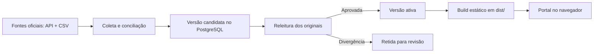

<p align="center">
  
</p>

<h1 align="center">Clareia</h1>

<p align="center"><strong>O poder, em números.</strong><br>Explore despesas, projetos e votações parlamentares. Compare recortes. Confira as fontes.</p>

<p align="center">
  <a href="https://github.com/jvitorbarros15/clareia/actions/workflows/ci.yml"></a>
</p>

<p align="center">
  <a href="#o-projeto">O projeto</a> ·
  <a href="#dados-e-metodologia">Metodologia</a> ·
  <a href="#rodar-localmente">Rodar localmente</a> ·
  <a href="#contribuir">Contribuir</a>
</p>

---

## O projeto

O **Clareia** transforma dados públicos sobre representantes brasileiros em uma experiência de investigação acessível e transparente. A proposta é aproximar a pergunta da evidência: encontrar um número, entender o contexto e chegar aos registros que o compõem.

A interface combina direção editorial, retratos, gráficos interativos e a pergunta **“Como chegamos nisso?”**. Hoje, ela cobre as despesas da Cota para o Exercício da Atividade Parlamentar (CEAP) da Câmara dos Deputados e, separadamente, a atividade legislativa: projetos apresentados e votos nominais. Atividade legislativa mostra produção e posicionamento; ela nunca é relacionada a dinheiro.

### O que você pode explorar

| Recurso | Experiência |
| --- | --- |
| **Busca investigativa** | Perguntas como “Quem mais gastou com passagens?” e comparações entre os representantes da amostra. As respostas usam regras locais sobre os registros publicados. |
| **Comparações interativas** | Ordenação por despesas, comparação lado a lado e filtros de categoria para entender como o resultado muda. |
| **Gráficos conectados** | Composição das despesas, evolução mensal e destaques por categoria, com valores e registros acessíveis a partir da interface. |
| **Atlas de representantes** | Mapa de hexágonos por UF de representação. Não indica onde o dinheiro foi gasto. |
| **Fornecedores** | Fornecedores de cada categoria, com busca por nome e lista que cresce aos poucos. |
| **Projetos de lei** | Proposições de cada deputado, separando autoria e coautoria, com situação e norma gerada quando houver. Lista com busca, cinco itens por vez. |
| **Votações nominais** | Como cada deputado votou em cada votação nominal, com busca por assunto, tipo ou voto. |
| **Evidências e exportação** | Painéis “Como chegamos nisso?”, do total ao deputado e do deputado a cada lançamento, com referências oficiais e download em CSV. |
| **Acompanhamento pessoal** | Perfis salvos no navegador, sem conta. Interface responsiva e ícones para adicionar o site à tela inicial no iOS e Android. |

### Cobertura atual

Esta `main` contém um **piloto com dados reais de três deputados, em janeiro e fevereiro de 2025**, na legislatura 57. O recorte está definido em [`config/pilot.json`](config/pilot.json).

- A amostra é técnica: as ordenações não representam um ranking nacional.
- Os valores medem despesas registradas na CEAP no período, não o custo total nem a qualidade de um mandato.
- Com uma cobertura de pessoas aprovada, partido e UF são os de cada mês de competência; sem ela, o site mostra o cadastro atual, marcado como “(atual)”. Quem não tem exercício confirmado no ano aparece assim, nunca com R$ 0,00.
- Projetos de lei e votações nominais têm coletores e publicações próprios e só aparecem no site depois de aprovados. Emendas já têm coletor, mas ainda não são exibidas; eleições e patrimônio ainda não foram coletados.
- A busca atual não usa um modelo de IA ou RAG. O acompanhamento salva favoritos localmente, sem enviar notificações.

O coletor de despesas da `main` restringe o piloto a três IDs e dois meses. Ampliar a cobertura exige validar o pipeline; não basta alterar a configuração.

## Dados e metodologia

**Todo número precisa de um caminho até a fonte.** O pipeline preserva a origem dos registros, trabalha com valores em centavos e mantém versões das publicações.

1. **Coletar e conferir estabilidade.** A API é consultada em dois passes, com tamanhos de página diferentes; o arquivo anual também é capturado duas vezes.
2. **Conciliar as fontes.** As ocorrências são pareadas por identidade, competência, documento, categoria e valor, com conferência adicional de número, emissão e lote. Registros presentes em apenas uma fonte seguem regras explícitas.
3. **Preservar o significado.** Ajustes negativos mantêm o sinal. Campos ausentes permanecem desconhecidos. Ocorrências ambíguas e divergências retêm a nova publicação para revisão.
4. **Recalcular antes de ativar.** Uma segunda implementação relê os originais preservados e compara os resultados com o banco. Somente versões com auditoria aprovada podem ficar ativas.
5. **Gerar o site.** O build calcula totais por mês, categoria e fornecedor e recusa a publicação se eles não baterem com os registros. A página abre só com esses totais; os lançamentos de um deputado são baixados quando alguém abre a lista dele.

A segunda implementação ajuda a detectar diferenças de processamento. Ela compartilha regras metodológicas com o coletor e **não constitui uma revisão independente dessas regras**, nem comprova completude da fonte ou legitimidade de uma despesa.

Fornecedores pessoa física são apresentados como “Fornecedor pessoa física”. Os originais ficam fora do Git e do diretório público. Na automação, originais arquivados e cópias do banco recebem criptografia AES-256-GCM, e o site gerado e o dump do banco passam por uma varredura de CPF antes da persistência da nova cópia.

Fontes utilizadas: [API de Dados Abertos da Câmara](https://dadosabertos.camara.leg.br/api/v2/api-docs) e [arquivo anual CEAP de 2025](https://www.camara.leg.br/cotas/Ano-2025.csv.zip). As [notas técnicas do piloto](real/README.md) registram a conciliação, capturas anteriores e limitações encontradas; os dados servidos em cada build são identificados pelo seu `manifest.json`.

## Rodar localmente

**Requisitos:** Git, Node.js 22 ou superior, npm e acesso à internet para a primeira coleta. O modo local usa PostgreSQL embarcado via PGlite; não exige configurar um servidor de banco ou Cloudflare R2.

```sh
git clone https://github.com/jvitorbarros15/clareia.git
cd clareia
npm ci
```

Colete o recorte, confira os originais e gere a primeira versão do site, avançando apenas quando cada comando concluir com sucesso:

```sh
npm run collect
npm run verify:annual
npm run build:site
npm run dev
```

Abra **[http://127.0.0.1:4174](http://127.0.0.1:4174)**.

`collect` grava uma versão candidata de despesas. `verify:annual` registra a auditoria que permite sua ativação. `build:site` gera `dist/` a partir da versão ativa; `dev` apenas serve essa pasta, sem recompilar automaticamente. Se ainda não houver uma versão aprovada, o build recusa a publicação.

Cobertura de pessoas, projetos, votações e emendas seguem o mesmo princípio, com comandos próprios: `collect:people`, `collect:bills`, `collect:votes` e `collect:amendments` geram e auditam a coleta; `publish:people`, `publish:bills`, `publish:votes` e `publish:amendments` aceitam `--dry-run` para conferir e `--approve` para ativar. Sem `DATABASE_URL`, os comandos de publicação exigem `--local`.

O banco local fica em `data/local/postgres`; as capturas da coleta, em `data/runs/`. Ambos são ignorados pelo Git. Após editar a interface, execute `npm run build:site` novamente e recarregue a página. Interrompa o servidor antes de repetir a sequência de coleta, auditoria e build.

### Configuração opcional

| Variável | Uso |
| --- | --- |
| `PORT` | Porta do servidor local. Padrão: `4174`. |
| `DATABASE_URL` | Conexão com PostgreSQL externo. Se ausente, usa PGlite local. |
| `TEST_DATABASE_URL` | Banco PostgreSQL externo para testes de integração; configurado no CI. |
| `R2_ACCOUNT_ID`, `R2_BUCKET`, `R2_ACCESS_KEY_ID`, `R2_SECRET_ACCESS_KEY` | Arquivamento e restauração no Cloudflare R2. O fluxo local básico não depende dessas variáveis. |
| `CLAREIA_VAULT_KEY` | Chave de 32 bytes codificada em base64 para os arquivos cifrados no armazenamento remoto. |

Veja [`.env.example`](.env.example). As variáveis precisam estar no ambiente do processo: arquivos `.env` não são carregados automaticamente. Configure credenciais da automação nos secrets do GitHub.

## Desenvolvimento e verificações

Para verificar o código, sem fazer uma nova coleta:

```sh
npm run typecheck
npm test
```

Para conferir os dados locais coletados:

```sh
npm run verify:annual
npm run verify:api-annual
```

Para testar a interface, instale a dependência opcional de navegador e mantenha `npm run dev` ativo em outro terminal:

```sh
npm install --no-save --package-lock=false playwright
npx playwright install chromium
npm run verify:browser
npm run verify:ui
```

Os testes de navegador conferem valores contra os arquivos publicados, navegação até os registros, exportação e comportamento da interface em diferentes larguras. Relatórios e capturas de tela ficam em `output/qa/`, fora do Git.

## Arquitetura

O processamento acontece antes da publicação. A navegação pelo site gerado não precisa consultar um banco ou a API da Câmara a cada visita.



| Camada | Tecnologias |
| --- | --- |
| Interface | HTML, CSS e JavaScript, com gráficos SVG e fontes locais. |
| Coleta e processamento | TypeScript sobre Node.js; Zod, `csv-parse` e `fflate`. |
| Persistência | PostgreSQL; PGlite no ambiente local e `pg` para banco externo. |
| Build | esbuild e geração de HTML, JavaScript, JSON e CSV estáticos. |
| Qualidade | TypeScript, executor de testes do Node.js, Playwright e GitHub Actions. |
| Arquivamento | Cloudflare R2 e criptografia AES-256-GCM. |

### Organização do repositório

```text
clareia/
├── real/                Interface, ícones, fontes e retratos
├── src/                 Coleta, conciliação, banco, publicação e servidor local
├── scripts/             Auditorias, build e verificações de navegador
├── tests/               Testes automatizados
├── config/              Recorte do piloto
└── .github/workflows/   CI e automações de coleta
```

`dist/`, `data/` nas pastas de execução e `output/qa/` são artefatos locais; não fazem parte da distribuição do código.

### Atualização e publicação

O [workflow de coleta](.github/workflows/collect.yml) está definido para três execuções diárias, além da execução manual. Ele restaura o banco cifrado do R2, verifica alterações, coleta, gera o site e preserva o estado. A auditoria da nova versão depende da variável de repositório `PUBLISH_ENABLED=true`.

Na `main`, `--if-changed` verifica a impressão digital do **arquivo anual**: uma mudança apenas na API ainda não dispara uma nova coleta. Portanto, a agenda não equivale a uma garantia de atualização de todas as fontes.

O build produz `dist/` para hospedagem estática. A versão de teste é publicada manualmente no Cloudflare Workers, como site estático e fora dos buscadores; o workflow de coleta ainda não faz deploy. O [CI](.github/workflows/ci.yml) executa a checagem de tipos e os testes em pushes e pull requests.

## Evolução da plataforma

A expansão segue a validação das fontes e das regras de cada domínio:

1. Concluir a revisão da cobertura de pessoas e dos meses retidos aguardando esclarecimento da Câmara.
2. Ampliar as despesas para todos os deputados de 2025 e implementar a atualização de 2026, com ciclos próprios para API e arquivo anual. O site já abre só com totais e baixa os lançamentos sob demanda, o que permite esse volume.
3. Exibir as emendas depois da revisão da identificação dos autores, distinguindo ano da emenda, execução e pagamento.
4. Integrar eleições e patrimônio a partir do TSE.
5. Automatizar o deploy do site gerado.

A busca com IA e RAG é uma direção futura: respostas numéricas deverão vir de consultas verificáveis, com contexto e fontes explícitas.

## Contribuir

Abra uma [issue](https://github.com/jvitorbarros15/clareia/issues) com o comportamento observado, o recorte e, quando disponível, a versão e a referência oficial. Para mudanças na interface, inclua a largura da tela e uma captura; para mudanças nos dados, descreva a regra e um caso que permita reproduzi-la sem expor identificadores pessoais.

Pull requests devem explicar o problema, o comportamento resultante e a verificação realizada. Mudanças metodológicas precisam preservar a rastreabilidade e manter casos incertos explícitos. Execute `npm run typecheck` e `npm test` quando alterar código, acrescentando verificações de navegador para mudanças de interação.

O protótipo com dados fictícios está preservado na tag [`mvp-final`](https://github.com/jvitorbarros15/clareia/tree/mvp-final). A interface atual consome as publicações reais aprovadas.
