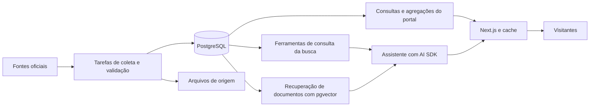

# Clareia — proposta de stack técnica

> Pesquisa e recomendação · 31 de outubro de 2026  
> Status: proposta para discussão; serviços e bibliotecas ainda não foram provisionados ou instalados.  
> Contexto: o desenvolvedor já usa JavaScript, TypeScript ou React. A identidade visual será escolhida depois.

## 1. Recomendação

Usar **TypeScript + React + Next.js**, com **PostgreSQL + Drizzle**, uma base visual em **Tailwind CSS + shadcn/ui** e **Apache ECharts** para gráficos e o primeiro mapa.

Manter frontend, endpoints e tarefas de coleta em TypeScript inicialmente. A proposta aproveita a experiência existente, facilita compartilhar definições de dados e permite construir o portal gradualmente.

TypeScript adiciona verificação de tipos ao desenvolvimento em JavaScript. Isso ajuda a manter contratos entre os dados, os cálculos e a interface, mas não substitui a validação dos registros recebidos das APIs. Referência: [TypeScript Handbook](https://www.typescriptlang.org/docs/handbook/intro.html).

## 2. Componentes propostos

| Camada | Escolha proposta | Aplicação no Clareia |
| --- | --- | --- |
| Linguagem | TypeScript | Interface, endpoints, regras de consulta e coleta inicial |
| Framework web | Next.js com React e App Router | Rankings, perfis públicos, filtros e endpoints do portal |
| Estilo e componentes | Tailwind CSS + shadcn/ui | Identidade visual própria, filtros, tabelas, painéis e busca |
| Visualização | Apache ECharts + GeoJSON oficial | Gráficos temporais, categorias e mapa por UF |
| Banco principal | PostgreSQL gerenciado, com Neon como primeira opção a avaliar | Pessoas, mandatos, despesas, projetos, votos e agregações |
| Acesso ao banco | Drizzle ORM + SQL quando necessário | Esquema em TypeScript, migrações e consultas de dados |
| Tarefas de fundo | Trigger.dev, sujeito à avaliação de plano e limites | Importações agendadas, processamento em lotes e novas tentativas |
| Hospedagem web | Vercel como primeira opção a avaliar | Publicação do Next.js e ambientes de prévia |
| Busca com IA | AI SDK + ferramentas de consulta; pgvector quando entrar o RAG | Respostas baseadas em cálculos e documentos recuperados |
| Arquivos | Armazenamento de objetos, fornecedor a escolher | Arquivos de origem e recursos que precisem ser preservados fora do banco |

Esta lista descreve a direção completa. A primeira entrega começa com aplicação, banco e um fluxo de importação; a camada de IA entra quando os dados e as métricas estiverem conferidos.

## 3. Por que essa combinação

### Next.js e React

O Next.js permite compor páginas renderizadas no servidor com componentes interativos no navegador. Para este portal, propomos renderizar a estrutura pública e os resultados iniciais no servidor, deixando filtros, gráficos e interações nos componentes de cliente. Referência: [Server and Client Components](https://nextjs.org/docs/app/getting-started/server-and-client-components).

Aproveitar o cache para resultados compartilhados, com revalidação após a atualização da base. A política precisa ser explícita, incluindo período, filtros e versão dos dados. Referência: [Caching no Next.js](https://nextjs.org/docs/app/getting-started/caching).

Há uma curva de aprendizado em limites entre servidor e cliente e invalidação de cache. Vamos documentar esses padrões e manter poucos caminhos de consulta para evitar comportamentos difíceis de depurar.

### Tailwind CSS e shadcn/ui

Tailwind oferece utilitários para implementar estilos e estados; shadcn/ui disponibiliza componentes cujo código pode ser adaptado ao projeto. Propomos usar essa base para os controles e desenvolver os cartões com retratos e a linguagem visual do Clareia. Referências: [Tailwind CSS](https://tailwindcss.com/docs/styling-with-utility-classes) e [shadcn/ui](https://ui.shadcn.com/docs).

### PostgreSQL e Drizzle

As principais consultas envolvem relações, filtros, somas e contagens: despesas por parlamentar e período, projetos por autor e votos por proposta. PostgreSQL será a fonte dos números exibidos pelo portal.

Drizzle permite definir o esquema em TypeScript e oferece consultas próximas de SQL. Para agregações mais complexas, manter SQL explícito e revisável. Referência: [Drizzle ORM](https://orm.drizzle.team/docs/overview).

Neon é a primeira opção de PostgreSQL gerenciado a avaliar. Na implantação, escolher uma conexão compatível com o ambiente de execução e controlar o número de conexões; posicionar aplicação e banco próximos entre si. Referência: [Connection pooling no Neon](https://neon.com/docs/connect/connection-pooling).

### Gráficos e mapa

ECharts oferece gráficos interativos de diferentes tipos, incluindo séries de mapa. Propomos começar com essa biblioteca para reduzir o número de sistemas visuais que precisam ser mantidos. Referência: [Apache ECharts](https://echarts.apache.org/en/feature.html).

O mapa usará geometria oficial e dados agregados por UF, com legenda e detalhes acessíveis. Carregar apenas as partes e visualizações necessárias à tela. Avaliar d3-geo se surgirem necessidades cartográficas que justifiquem uma implementação própria; referência: [d3-geo](https://d3js.org/d3-geo).

### Coleta em tarefas de fundo

Importações devem executar fora da navegação do visitante. Trigger.dev oferece tarefas com agendamento, filas e novas tentativas; seus processos executam no serviço de tarefas. A integração ainda precisa ser validada com uma importação representativa. Referência: [Trigger.dev](https://trigger.dev/docs/introduction).

Cada importação deverá permitir retomada, identificar registros já processados e registrar data e origem. Publicar uma atualização da base somente após validar o lote, preservando a versão anterior enquanto a nova estiver incompleta.

## 4. Arquitetura proposta

Inicialmente, uma aplicação web com módulos bem definidos e um conjunto de tarefas de fundo. Os mesmos cálculos de gastos e projetos devem alimentar rankings, gráficos e respostas do assistente.

## 5. Centenas ou milhares de visitantes por dia

Esse é um alvo de planejamento razoável para a arquitetura proposta. A capacidade real depende dos picos de acesso, número de páginas por visita, consultas executadas, volume da base e uso da IA. Ainda não existe um teste de carga que demonstre capacidade.

Exemplo puramente ilustrativo: 10.000 visitantes por dia, com cinco páginas cada, representam 50.000 visualizações por dia, ou cerca de 0,58 por segundo na média. Uma notícia pode concentrar muitas dessas visitas em poucos minutos. A média diária não informa o pico que precisa ser atendido.

Medidas de implementação:

- Rankings frequentes pré-calculados e resultados públicos com cache.
- Consultas filtradas e paginadas; o navegador recebe o recorte necessário.
- Índices definidos pelas consultas reais e observação das consultas lentas.
- Importações em lotes, com concorrência controlada.
- Retratos otimizados e bibliotecas de gráficos carregadas nas telas que as utilizam.
- Conexões ao banco controladas e dados próximos do servidor da aplicação.
- Atualização coordenada dos resultados após cada lote validado.

Antes do lançamento, medir páginas e endpoints representativos com carga crescente, incluindo um pico de acesso e uma importação concorrente. Observar latência, erros, uso do banco e taxa de acerto do cache.

## 6. Busca com IA

Usar AI SDK como integração em TypeScript para os modelos e a interface de resposta. A biblioteca fornece uma API comum para diferentes provedores. Referência: [AI SDK](https://ai-sdk.dev/docs/introduction).

A proposta permanece híbrida:

- **Valores e rankings:** ferramentas restritas consultam os dados estruturados e retornam resultados calculados.
- **Explicações de projetos e regras:** recuperação de documentos relevantes, seguida de resposta com referências.
- **Perguntas combinadas:** coordenar as duas consultas, mantendo os filtros explícitos.

Para os documentos, pgvector permite guardar embeddings e realizar busca por similaridade no PostgreSQL. Avaliar a qualidade junto de busca textual e filtros por documento, data e assunto. Referência: [pgvector no Neon](https://neon.com/docs/extensions/pgvector).

Escolher modelo e fornecedor após medir qualidade em português, precisão das referências, tempo de resposta e custo em perguntas reais. O custo de IA depende do número de perguntas, tamanho do contexto e tokens gerados, e deve ter orçamento e limites próprios.

## 7. Custo, evolução e decisões pendentes

Ainda não há orçamento mensal aprovado ou estimativa de uso suficiente para escolher planos. Verificar preços e limites no momento da contratação. O dimensionamento deve considerar hospedagem, banco, arquivos e tráfego, tarefas de coleta e consumo de IA separadamente.

Redis pode entrar quando houver necessidade concreta de cache compartilhado ou controle de uso do assistente. Um serviço dedicado de busca ou armazenamento vetorial será reavaliado se o PostgreSQL não atender aos requisitos medidos.

Python pode ser acrescentado às tarefas de dados caso apareça uma biblioteca ou carga de processamento que traga vantagem clara. A recomendação inicial mantém TypeScript como linguagem principal.

Decisões para a próxima etapa:

1. Confirmar a stack proposta.
2. Definir um orçamento inicial e o primeiro volume de dados.
3. Escolher regiões e planos de hospedagem, banco e tarefas.
4. Validar uma importação real e um ranking completo.
5. Medir o fluxo antes de ampliar a cobertura e introduzir IA.

Critérios de escolha: desenvolvimento confortável com a experiência existente, consultas verificáveis, manutenção simples, custos observáveis e capacidade validada por medições.
