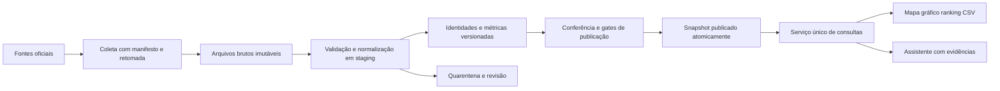

# Clareia — plano de dados reais e publicação confiável

Data: 1º de novembro de 2026. Branch: `plan/official-data-quality`.

**Status: planejamento, sem importação ou migração implementada.** `main` preserva o MVP demonstrativo. Nenhuma credencial, serviço ou infraestrutura nova foi provisionada.

## 1. Resultado pretendido

Entregar uma investigação reproduzível: UF → representantes → período → categoria → fornecedor → registros oficiais. Ranking, mapa, gráfico, CSV e assistente devem concordar porque usam a mesma definição e a mesma versão da base.

Não prometer “zero falsos positivos”. A origem pode conter erros, retificações e lacunas. O compromisso é não publicar atribuições incertas como fatos, bloquear resultados quando os controles falharem e medir os erros encontrados. **Não criar um detector de corrupção nesta fase.** Um valor elevado, um fornecedor compartilhado ou um pico temporal não demonstram irregularidade.

## 2. Entregas em ordem

| Marco | Escopo | Condição para avançar |
| --- | --- | --- |
| A — laboratório de fontes | Uma legislatura, três deputados, dois meses fechados, incluindo uma substituição se encontrada | Contratos de origem documentados; registros e cálculos conferidos independentemente |
| B — primeira investigação real | Câmara: pessoas, exercício, CEAP e geografia por UF; primeiro ano fechado escolhido após perfilamento | Todas as páginas/arquivos esperados processados; nenhum desvio financeiro inexplicado; links e recortes reproduzíveis |
| C — cobertura Câmara | Histórico escolhido explicitamente; propostas, autoria, tramitações e votos nominais | Contratos próprios por domínio; testes de coautoria, etapas e categorias de voto |
| D — cruzamento entre fontes | TSE: candidatura, bens declarados, resultados; CGU: emendas e destinos | Tabelas de correspondência auditadas; ambiguidade não resolvida fica sem vínculo |
| E — outras Casas e poderes | Senado; depois avaliar dados estaduais e municipais individualmente | Conector e metodologia próprios. Não presumir API nacional uniforme nem juntar cotas diferentes |
| F — assistente real | Consultas determinísticas + recuperação de documentos | Avaliações de atribuição, aritmética, citações e recusa aprovadas; resposta bloqueada quando falta evidência |

No marco B, os demais módulos continuam explicitamente demonstrativos em uma rota de demonstração separada. Nunca misturar políticos reais com registros fictícios na mesma visualização. A seleção das três interfaces muda a apresentação, não o dataset real — o comportamento atual de fixtures diferentes entre designs deve ficar restrito à demonstração.

## 3. Inventário de fontes

Fontes oficiais consultadas nesta sessão. Disponibilidade de documentação não comprova integridade dos dados, contrato de unicidade ou cobertura histórica. Fixar cópia/hash do contrato e validar novamente na implementação.

| Fonte | Entrada oficial | Uso e trabalho pendente |
| --- | --- | --- |
| Câmara | [Swagger](https://dadosabertos.camara.leg.br/swagger/api.html), [OpenAPI](https://dadosabertos.camara.leg.br/api/v2/api-docs), [portal](https://dadosabertos.camara.leg.br/) | Pessoas, CEAP, proposições e votações. API para consultas incrementais; avaliar arquivos anuais para carga histórica. A documentação informa paginação com limite de 100 itens; seguir os links retornados e validar o contrato antes de coletar |
| IBGE | [Localidades](https://servicodados.ibge.gov.br/api/docs/localidades), [malhas](https://www.ibge.gov.br/geociencias/todos-os-produtos-geociencias/15774-malhas.html) | Códigos oficiais e geometria versionada. Localidades consultadas; download e licença/metadados da malha ainda precisam ser validados. A página de malhas não pôde ser aberta nesta sessão |
| TSE | [Portal de dados](https://dadosabertos.tse.jus.br/) | Catálogos por eleição: candidatos, bens, resultados e contas. Selecionar recurso e ler o respectivo leiaute; não assumir que todos os anos usam o mesmo esquema |
| CGU | [Acesso à API](https://portaldatransparencia.gov.br/api-de-dados), [documentação](https://api.portaldatransparencia.gov.br/) | Emendas e documentos vinculados. Validar autenticação, limites, cobertura e granularidade antes do conector. Não somar linhas de etapas diferentes como se fossem dinheiro adicional |
| Senado | [Dados abertos](https://www12.senado.leg.br/dados-abertos) | Descoberta inicial. Endpoints, formatos e definições ainda não contratados; implementar separadamente da Câmara |

### Rotas Câmara a contratar primeiro

Base proposta: `https://dadosabertos.camara.leg.br/api/v2`.

- `/deputados`: universo por legislatura e filtros oficiais; não tratar só a lista atual como histórico completo.
- `/deputados/{id}` e `/deputados/{id}/historico`: identidade e situação temporal; confirmar se há informação suficiente para todos os intervalos de exercício.
- `/deputados/{id}/despesas`: registros de CEAP, ano/mês de referência e campos financeiros. Preservar os valores originais e sua semântica.
- `/proposicoes`, `/proposicoes/{id}/autores`, `/proposicoes/{id}/tramitacoes`: autoria e eventos; cobrir múltiplos autores e tipos de proposição.
- `/votacoes`, `/votacoes/{id}/votos`: votação específica e votos, vinculados ao objeto efetivamente votado.

Confirmar parâmetros, filtros, campos e significado de ausência de resposta no OpenAPI e em amostras antes de codificar cada contrato. Identificadores de domínios diferentes não são intercambiáveis.

## 4. Arquitetura proposta

Manter a direção TypeScript/PostgreSQL da [stack](../STACK-TECNICA.md). Esta branch não escolhe planos comerciais nem faz migração do MVP.



Estrutura de implementação futura:

```text
apps/web/                     interface escolhida e páginas públicas
packages/source-contracts/    esquemas de origem, versões e validações
packages/metrics/             definições, consultas e arredondamento
packages/identity/            chaves oficiais e correspondências revisadas
workers/ingestion/            conectores, manifesto, retomada e agendamento
db/                          esquema, constraints e migrações
tests/fixtures/               exemplos mínimos sanitizados e casos adversariais
```

Nada de coleta oficial durante uma visita ao site. O visitante consulta somente snapshots publicados. Agregações frequentes podem ser materializadas; caches incluem versão do snapshot e parâmetros. O armazenamento bruto fica fora do Git e as credenciais somente no servidor.

## 5. Modelo de dados mínimo

| Entidade | Chave/atributos essenciais | Invariante |
| --- | --- | --- |
| `source_run` | fonte, escopo, início/fim, versão do coletor, estado, manifesto | Uma execução incompleta nunca vira snapshot público |
| `raw_object` | URL sem segredo, parâmetros seguros, data de coleta, hash, local do arquivo, página/recurso | Preservar resposta original; nova versão não sobrescreve evidência anterior |
| `person` / `source_identity` | ID interno; namespace + ID oficial; validade; evidência | Mesmo nome não implica mesma pessoa |
| `mandate_period` / `affiliation_period` | pessoa, Casa, UF, partido, início/fim, fonte | Não aplicar partido atual retroativamente; intervalos desconhecidos permanecem desconhecidos |
| `expense_record` / `expense_revision` | chave de origem contratada, pessoa, período de referência, data do documento, valores, categoria, fornecedor, documento, snapshot | Chave de despesa não é nome do fornecedor nem só número impresso da nota |
| `supplier` | namespace, identificador oficial normalizado, tipo; nome como atributo | Sem identificador confiável, não fundir fornecedores por semelhança textual |
| `proposal` / `proposal_author` / `proposal_event` | IDs oficiais, papel de autoria e eventos ordenados | Coautoria não duplica uma proposta dentro da mesma métrica |
| `vote` / `roll_call` | ID da votação, objeto, data, pessoa, categoria original | Falta de registro não é automaticamente ausência |
| `geography` | código IBGE como string, tipo, vigência, versão da malha | Nome de município sozinho não é chave |
| `crosswalk` | origem/destino, regra, evidência, decisão, revisor, vigência | Ambíguo ou contraditório não participa de agregações cruzadas |
| `published_snapshot` / `metric_definition` | versão, cobertura, hash do manifesto; fórmula e elegibilidade | Cada resposta aponta para uma versão e uma definição reproduzíveis |

Armazenar dinheiro em centavos inteiros ou `numeric` de precisão fixa, preservando sinal. Não usar floats JavaScript para a soma canônica. Arredondar somente na apresentação. Datas de referência, documento, atualização da origem e coleta são campos distintos.

### Chave de despesa: decisão obrigatória antes da carga completa

Perfilar campos como `codDocumento`, `codLote`, parcela e ressarcimento, quando presentes, e verificar o contrato oficial. **Não declarar `codDocumento` globalmente único sem prova.** Pode haver correções, parcelas ou eventos associados ao documento.

Guardar ocorrências brutas e comparar chaves candidatas. Uma repetição exata de página pode ser reprocessamento; linhas iguais dentro da origem podem ser eventos distintos. Hash de conteúdo ajuda a detectar repetição, mas não autoriza apagar eventos financeiros. Se a granularidade continuar ambígua, o lote fica bloqueado para métricas financeiras.

## 6. Coleta e atualização

1. Fixar escopo explícito (Casa, legislatura, período, domínios); registrar o universo esperado.
2. Ler contrato e listar páginas/arquivos necessários. Guardar manifesto com hashes, status HTTP, contagens, limites temporais e checkpoint.
3. Usar timeouts, concorrência limitada e tentativas com espera crescente; respeitar `Retry-After` quando fornecido. Definir limites operacionais medidos, sem inventar uma cota da API.
4. Seguir paginação até o fim; detectar loops, páginas repetidas, respostas vazias inesperadas, falhas parciais e mudanças de esquema. Não interpretar timeout como lista vazia.
5. Se a API mudar durante a paginação, repetir/reconciliar o recorte até haver estabilidade; registrar início/fim da captura. Não alegar snapshot transacional da origem quando ela não o oferece.
6. Preservar bruto, validar staging, aplicar chaves comprovadas e resolver apenas identidades inequívocas. Guardar motivos de exclusão/quarentena.
7. Conferir agregações independentes e diferenças em relação ao snapshot anterior. Toda divergência precisa de explicação registrada, não de tolerância silenciosa.
8. Publicar em transação: apontar a versão ativa para o novo snapshot aprovado. O anterior permanece disponível para rollback e links históricos.

Proposta inicial de atualização a testar: diária para períodos recentes; rechecagem semanal do restante do ano; conferência mensal do histórico publicado. A janela recente deve ser escolhida após observar retificações — não assumir que mês fechado é imutável. Não depender só de um campo “updated_at” se a fonte não o garantir.

Excluir um registro da visão atual só após evidência de retirada/retificação e coleta completa; preservar a revisão anterior. Falha ou diferença de cobertura nunca apaga o histórico silenciosamente.

## 7. Regras para evitar atribuições e interpretações falsas

### Identidade

- Dentro de uma fonte, usar namespace + identificador oficial, preservando zeros à esquerda.
- Entre Câmara e TSE, ID de deputado e ID de candidatura são identidades de domínios diferentes. Candidatura deve ser contextualizada pela eleição; não presumir identidade global.
- Nome aproximado pode gerar tarefa de revisão, nunca vínculo publicado automático.
- Mudança de nome, UF ou partido não prova nova pessoa; homônimo não prova a mesma pessoa. Conflitos de evidência bloqueiam a associação.
- Toda decisão manual guarda justificativa, fontes e revisor. Reprocessar descendentes quando uma correspondência muda.
- Identificadores pessoais eventualmente necessários ao vínculo não devem aparecer no frontend, logs, busca vetorial ou fixtures públicas. Minimizar coleta e acesso; definir retenção antes da integração.

### Valores e recortes

- “Gastos” no primeiro release significa **reembolsos líquidos CEAP no período de referência definido**. Não inclui salário, verba de gabinete ou emendas.
- Contratar a semântica de `valorLiquido`, glosa, restituições e parcelas com a fonte. Não aplicar uma fórmula deduzida do nome do campo nem subtrair estorno duas vezes.
- Preservar eventos negativos legítimos. Valor negativo é sinal para conferir a semântica, não motivo automático de exclusão.
- Separar total da UF, média por representante e média por tempo em exercício. Mostrar denominador e política para meses parciais. Bloquear a média por exercício se os intervalos não estiverem confirmados.
- Definir elegibilidade de rankings e desempates. “Menos gastou” não inclui perfis com cobertura incompleta como se fossem gasto zero.
- Valores de anos diferentes são nominais, salvo série corrigida explicitamente identificada com índice, base e fórmula.
- Proposta apresentada, relatada, aprovada em comissão, aprovada pela Casa e convertida em lei são estados distintos. Contagem não é nota de qualidade.
- Votação pode tratar um destaque ou requerimento, não o projeto inteiro. A interface deve informar exatamente o objeto e a categoria original do voto.
- Emendas: indicação, empenho, liquidação, pagamento e restos a pagar têm semânticas distintas. Validar a granularidade de cada fonte; evitar dupla contagem por autor, documento e beneficiário.

### Geografia

- Mapa da Câmara usa UF de representação vigente conforme definição temporal, não localização do fornecedor.
- Mapa de emendas usa destino explicitamente registrado; sede do beneficiário não é automaticamente local da entrega.
- Homônimos de municípios exigem código oficial e UF. Se houver mudança territorial, usar a versão compatível com o período.
- Destinos nacionais, múltiplos ou desconhecidos não são colocados artificialmente em um município. Nenhum rateio inventado.

## 8. Métricas como contratos

Cada métrica terá: identificador/versionamento, população elegível, período e campo temporal, unidade, fórmula, inclusão/exclusão, denominador, política de nulos/zero, precisão, fonte e testes.

Exemplo proposto `ceap.reembolso_liquido.v1`: soma dos eventos líquidos válidos da fonte, para pessoa/período/categoria/snapshot selecionados; granularidade aprovada antes do lançamento. Se a fonte não permitir interpretar eventos de modo inequívoco, a métrica não é publicada.

Resposta do serviço deve conter `value`, `unit`, `filters`, `metricVersion`, `snapshotId`, `coverage`, `sourceRefs`, `computedAt`, `qualityStatus` e `limitations`. `qualityStatus` distingue disponível, incompleto, indisponível e retido para revisão. O frontend não converte `null` em zero.

“Como chegamos nisso?” mostra fórmula, período, denominador, registros incluídos, exclusões justificadas, atualização e acesso à origem. CSV e gráficos carregam o mesmo identificador de consulta. Comprovante indisponível recebe esse estado; a página pode citar o registro oficial, mas nunca inventar um comprovante.

## 9. Gates de publicação

| Gate | Aceite | Falha |
| --- | --- | --- |
| Completude | Manifesto cobre todos os arquivos/páginas do escopo contratado | Manter snapshot anterior; sinalizar atualização atrasada |
| Esquema | Campos obrigatórios e tipos validados; mudanças investigadas | Quarentena do lote |
| Identidade | Nenhum vínculo ambíguo entre registros publicados | Reter vínculo e métricas dependentes |
| Unicidade | Chaves e revisões respeitam a granularidade contratada | Bloquear agregação afetada |
| Financeiro | Soma por registro, categoria, pessoa, mês e UF reconcilia exatamente | Bloquear publicação financeira |
| Independência | Amostra comparada à origem/arquivo ou cálculo independente, não só à mesma função | Não lançar release inicial sem conferência |
| Cobertura | Nenhuma lacuna convertida em zero ou denominador silenciosamente reduzido | Reter ranking comparativo afetado |
| Temporal/geográfico | Vigência e códigos coerentes | Reter associação ou publicar explicitamente indisponível |
| Proveniência | Toda afirmação numérica alcança definição e registros da versão citada | Não exibir a afirmação |

Zero divergências inexplicadas é um critério de release, **não uma prova de ausência universal de erro**. Um lote parcialmente retido pode gerar tabelas claramente parciais, mas não um ranking “dos que mais/menos” para a população inteira.

## 10. Avaliação e falsos positivos

Criar conjunto de referência revisado, versionado e separado do desenvolvimento. Incluir amostragem aleatória e casos difíceis; revisão humana independente dos resultados do algoritmo.

Registrar para correspondências automáticas: verdadeiros/falsos vínculos, vínculos perdidos, casos recusados e casos sem verdade conhecida. Medir precisão, cobertura e taxa de revisão. Recusar tudo não é sucesso; medir também recall quando houver verdade conhecida. Resultado sem rótulo confiável não entra como “acerto”. Publicar tamanho da amostra e intervalo de confiança, não “100% seguro” após poucas verificações.

Para o primeiro release: nenhum falso vínculo conhecido na amostra revisada e nenhum caso ambíguo publicado; divergências aritméticas inexplicadas impedem publicação. Não abrir detector automático de irregularidade com base apenas nesses testes.

Casos mínimos e resultados esperados estão em [MATRIZ-DE-VALIDACAO.md](MATRIZ-DE-VALIDACAO.md).

## 11. Assistente e RAG

Primeiro construir consultas tipadas para totais, séries, comparação e evidências. O modelo interpreta a pergunta e escolhe uma consulta permitida; não gera SQL irrestrito nem calcula valores pela memória. A API valida período, entidades, escopo e autorização de leitura.

RAG entra para texto de propostas, tramitação e metodologia. Documentos carregam ID de origem, versão, data e trecho; texto recuperado é dado não confiável, nunca instrução para o agente. Valores financeiros vêm do serviço de métricas, mesmo quando um documento contém números.

Antes de responder: confirmar correspondência das pessoas; usar um só snapshot; verificar se a fonte sustenta a afirmação; conferir recorte e unidade. Se faltar dado ou a fonte divergir, explicar a lacuna e oferecer o recorte verificável. Perguntas com acusações devem retornar fatos verificáveis sem transformar correlação em conclusão.

Avaliações obrigatórias: homônimos, múltiplas pessoas, ano não coberto, base zero, fonte retirada, dado desatualizado, pergunta tendenciosa, comparação entre verbas incompatíveis, erro de ferramenta e instruções maliciosas em documento. Testar também citação correta com conclusão errada, não só existência de um link.

## 12. Operação e correção

Dashboard interno: atraso de atualização, falhas, cobertura, registros em quarentena, mudanças de esquema, divergências e vínculos aguardando revisão. Alertas operacionais não são acusações públicas.

Botão “Reportar um problema” deve carregar o ID da investigação, snapshot e métrica. Triagem: identificar resultado afetado → suspender afirmação se necessário → verificar origem → corrigir vínculo/regra → reprocessar dependentes → publicar nova versão → invalidar cache → registrar correção. Não reescrever silenciosamente uma investigação compartilhada antiga.

Chaves da CGU ou de IA ficam fora do cliente, Git, URLs e logs. Downloads de documentos usam origens permitidas, limites de tamanho, verificação de tipo e tratamento de PDF/OCR como conteúdo não confiável; OCR nunca substitui silenciosamente um campo estruturado oficial.

## 13. Próximo trabalho concreto

1. Criar contratos Câmara para pessoa, exercício e despesas e documentar campos com exemplos oficiais mínimos.
2. Fazer o laboratório do marco A, incluindo perfilamento de granularidade, paginação e retificações.
3. Implementar ingestão idempotente em staging e relatório de reconciliação; repetir a mesma carga e simular interrupção.
4. Implementar uma métrica CEAP e seu endpoint de evidências; comparar com cálculo independente.
5. Ligar mapa, gráfico, tabela e CSV a esse endpoint numa rota real separada da demonstração.
6. Revisar a matriz de validação e os limites de cobertura antes de expandir o período e o universo.

Decisões ainda abertas: design final, janela histórica inicial, provedor de banco/arquivos/tarefas, política para mês parcial em exercício, granularidade oficial da despesa e mapeamento entre fontes. Nenhuma delas é respondida por uma correspondência aproximada ou valor padrão silencioso.
