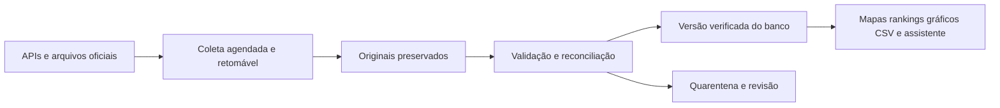

# Plano de coleta precisa e atualização contínua

Data: 1º de novembro de 2026. Status: **planejado, ainda não implementado**.

Este documento transforma a estratégia de atualização em tarefas de implementação. Complementa o [plano de dados reais](PLANO-DADOS-REAIS.md) e a [matriz de validação](MATRIZ-DE-VALIDACAO.md).

## Objetivo

Manter uma base própria, verificável e atualizada para alimentar mapas, rankings, gráficos, exportações e assistente. Visitantes consultam versões publicadas do banco; tarefas de fundo coletam e validam as fontes.

Podemos controlar o atraso entre a publicação na fonte e a coleta pelo Clareia. Não podemos garantir quando a fonte publicará o evento. Zero falsos positivos não é uma garantia possível: vínculos ambíguos e resultados sem evidência suficiente devem ser retidos.

## Fluxo de publicação

## 1. Coletores separados por fonte

| Fonte | Dados | Estratégia |
| --- | --- | --- |
| Câmara | Deputados, exercício, reembolsos, propostas e votos | Arquivos históricos quando adequados; API paginada para atualizações e detalhes |
| Senado | Senadores e atividade parlamentar | Conector e definições próprios; não presumir equivalência com a Câmara |
| TSE | Candidaturas, resultados, bens e contas | Arquivos por eleição; detectar novas versões e mudanças de leiaute |
| Portal da Transparência | Emendas e documentos financeiros relacionados | Carga histórica em lote; consultas direcionadas na API |
| IBGE | Identificadores e limites geográficos | Recursos versionados; registrar vigência e versão da malha |

A [documentação da Câmara](https://dadosabertos.camara.leg.br/api/v2/api-docs) informa paginação com até 100 itens por requisição. Cada coletor deve verificar todas as páginas necessárias. O [Portal da Transparência](https://portaldatransparencia.gov.br/api-de-dados) recomenda downloads para grandes volumes e exige token para a API, com limites de requisição. Confirmar contratos e limites na implementação; não fixar suposições silenciosas.

## 2. Cadência proposta

Os intervalos abaixo são hipóteses operacionais iniciais, não frequências garantidas pelas fontes nem SLAs já cumpridos. Ajustar após medir duração das cargas, alterações efetivas, cotas e erros.

| Domínio | Verificação inicial proposta |
| --- | --- |
| Votações recentes e tramitação de propostas | A cada 30–60 minutos para o conjunto recente/ativo definido |
| Perfis, exercício e filiações | Diariamente |
| Reembolsos recentes | Diariamente |
| Execução de emendas | Diariamente |
| Arquivos eleitorais | Verificação diária de mudanças durante publicação ativa; reduzir depois |
| Referências geográficas | Verificação mensal de novas versões |
| Restante do ano corrente | Reconciliação semanal |
| Histórico publicado | Varredura mensal rotativa, com manifesto de cobertura |

Definir a janela de “recente” após perfilamento; não assumir que um mês encerrado é imutável. Usar filtros de alteração somente quando a origem garantir sua semântica. Caso contrário, reler períodos sobrepostos e comparar versões. Alterações antigas precisam entrar pelas varreduras históricas.

Registrar o prazo para completar cada ciclo histórico. Se o volume não permitir cobrir o escopo no prazo proposto, ajustar a capacidade ou informar o prazo real; não chamar uma amostra de reconciliação completa.

## 3. Contrato operacional de cada tarefa

Cada execução deve registrar fonte, domínio, período, entidades, versão do coletor, início/fim, páginas ou arquivos esperados e obtidos, contagens, hashes, tentativas, checkpoint e resultado.

- Limitar concorrência por fonte, impedir execuções sobrepostas do mesmo recorte e distribuir tarefas no tempo.
- Usar timeout, novas tentativas com espera crescente e respeito a `Retry-After` quando disponível.
- Retomar de checkpoints sem duplicar eventos; repetir uma carga deve produzir o mesmo resultado lógico.
- Detectar loops de paginação, páginas repetidas, alterações de esquema e respostas vazias inesperadas.
- Preservar respostas originais e revisões; armazenar credenciais apenas no servidor, fora de URLs e logs.
- Quando houver suporte confiável a ETag ou Last-Modified, usar requisições condicionais; manter comparação por hash como mecanismo adicional, sem presumir suporte universal.
- Se a origem mudar durante a paginação, reconciliar ou repetir o recorte antes de publicá-lo.

## 4. Precisão antes da publicação

| Controle | Comportamento obrigatório |
| --- | --- |
| Identidade | Usar IDs oficiais com namespace; correspondências entre fontes exigem evidência. Nome parecido não autoriza vínculo |
| Granularidade | Validar o que identifica um evento financeiro antes de deduplicar; um documento pode ter parcelas ou revisões |
| Aritmética | Centavos inteiros ou decimal de precisão fixa; arredondar só para apresentar |
| Completude | Falhas e páginas ausentes não viram gasto zero |
| Reconciliação | Conferir totais por registro, pessoa, categoria, mês e UF; usar cálculo independente e comparação com origem |
| Proveniência | Número publicado aponta para registros, origem, definição da métrica e versão da base |
| Cobertura | Bloquear ranking comparativo se lacunas tornarem a classificação enganosa |

Exemplo obrigatório de teste: uma execução consegue 18 de 20 páginas. O novo recorte não é publicado. O site continua com a última versão aprovada, identifica a atualização atrasada e gera alerta operacional. Após a recuperação, a versão completa passa pelos controles antes de substituir a anterior.

Publicar a versão aprovada atomicamente. O cache deve incluir a versão da base; nenhum gráfico pode usar valores novos com tabela ou legenda antigas. Manter a versão anterior para recuperação e investigações compartilhadas.

## 5. Atualização visível para o usuário

Exibir separadamente:

- **Última consulta à fonte:** quando o coletor verificou a origem.
- **Período de referência:** a que período os registros se referem.
- **Atualização da fonte:** somente se informada de maneira confiável pela origem.
- **Última versão publicada no Clareia:** quando uma carga aprovada entrou no produto.
- **Cobertura e estado:** completo para o escopo, parcial, indisponível, atrasado ou retido para revisão.

Consultar hoje não significa que os dados cubram todos os eventos até hoje. Um resultado sem alterações pode atualizar a data de consulta, mas não deve aparentar uma nova publicação da fonte.

## 6. Monitoramento e recuperação

Monitorar por fonte e domínio: idade da última coleta bem-sucedida, idade da versão publicada, duração das tarefas, erros, novas tentativas, páginas faltantes, alterações de esquema, divergências financeiras e identidades pendentes.

Configurar alertas quando um ciclo esperado não terminar, houver mudança incompatível de contrato, soma inexplicada ou crescimento anormal de quarentena. Limiares dependem das medições do laboratório inicial.

Uma variação grande dispara conferência, não acusação pública. A correção deve registrar causa, escopo afetado, revisão da regra ou vínculo, reprocessamento, nova versão e invalidação do cache.

## 7. Assistente sobre a mesma base

O assistente usa consultas tipadas ao serviço de métricas para números e comparações. RAG recupera textos de propostas, tramitação e metodologia com fontes e versões. Não usar o modelo para calcular somas pela memória ou resolver identidades por semelhança.

Respostas devem carregar o mesmo recorte e snapshot dos gráficos e exportações. Se a consulta falhar, faltar cobertura ou houver ambiguidade, explicar a limitação em vez de produzir um valor presumido.

## 8. Ordem de implementação

- [ ] Escolher três deputados e dois meses encerrados para um laboratório Câmara, incluindo caso de substituição se disponível.
- [ ] Inspecionar contratos, paginação, campos financeiros, exercício e possíveis retificações.
- [ ] Implementar coleta com manifesto, preservação do bruto e checkpoint.
- [ ] Validar granularidade, deduplicação, identidade e aritmética.
- [ ] Conferir resultados com cálculo independente e amostra oficial revisada.
- [ ] Testar reexecução, interrupção, página faltante, revisão de valor e conflito de identidade.
- [ ] Publicar uma versão verificada e testar recuperação para a anterior.
- [ ] Conectar mapa, gráfico, tabela e CSV ao mesmo serviço de métricas.
- [ ] Medir duração, limites e frequência real de alterações; definir agenda e alertas com base nessas medições.
- [ ] Expandir o universo Câmara e o período apenas após aprovação dos controles.
- [ ] Adicionar outros domínios/fontes individualmente e executar seus testes específicos.
- [ ] Implementar o assistente real depois que os dados e as métricas estiverem validados.

## Critério de conclusão do primeiro marco

Um terceiro consegue reproduzir o total pelos registros oficiais; duas execuções equivalentes não duplicam valores; uma coleta parcial não altera o site; uma retificação preserva histórico; e cada visualização informa cobertura, período e versão. Registrar evidências dos testes, não apenas marcar as tarefas como feitas.
